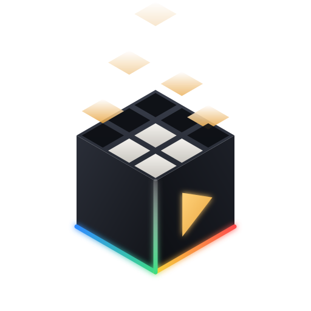

<p align="center"></p>

# AASL: An Another Somnium Launcher

AASL installs, launches and troubleshoots [Somnium Space](https://somniumspace.com) on Linux. It comes as a desktop app (Rust + [Freya](https://freyaui.dev)), a command line (`aasl`) and an MCP server. The MCP server lets a coding agent read the same state and logs you see and test fixes.

Status: early development, not yet tested end to end with a headset.

## What it does

1. Checks the system: distribution, Python, Vulkan, the OpenXR runtime and the OpenVR layer Proton needs.
2. Downloads Proton (GE-Proton or Proton-CachyOS) from GitHub releases, picks the build for your CPU (x86-64-v3 when possible) and verifies the upstream SHA-256.
3. Installs a Somnium patch bundle into that Proton: the Wine fixes for sign-in (TLS client certificates) and video playback, recorded so AASL notices if anything overwrites them.
4. Creates a Wine prefix and runs your own copy of Somnium's official installer inside it.
5. Waits for VR to be ready before launching, so WiVRn users do not land in desktop mode, then watches the processes and keeps the log.
6. When something breaks, `aasl doctor` names the cause and offers a fix you approve.

It never asks for root and writes only under your home directory.

## VR runtimes

| Runtime | Detection | What AASL checks |
|---|---|---|
| WiVRn | `wivrn-server`, Flatpak | manifest appears once a headset connects; server running; OpenVR layer (xrizer) |
| Monado | `monado-service`, `openxr_monado.json` | service running or IPC socket; OpenVR layer |
| Envision | `~/.local/share/envision` | same as Monado |
| SteamVR | Steam library | `vrserver` running |

Proton only hands OpenXR to a game when an OpenVR runtime is registered, so Monado-based runtimes need xrizer (or OpenComposite) in `openvrpaths.vrpath`. AASL shares the runtime's and the layer's directories with Proton's container automatically. ALVR is not covered.

## Compatibility recipes

A recipe is a Proton plus the fixes Somnium needs on it (TLS sign-in, video streams, YouTube sound). `recommended` is built in; make your own, share them as one TOML file, or let an agent write them over MCP. See `patches/README.md`.

```sh
aasl recipe list                    # recipes, * = in use
aasl recipe use recommended         # switch, build if needed, repair
aasl recipe build --proton ge:GE-Proton11-12   # build in podman/docker
aasl proton available cachyos       # upstream releases, with patch status
aasl proton use ge:GE-Proton11-5    # switch Proton under the current recipe
aasl patch status                   # bundle installed, files intact?
aasl session list                   # what each play session showed (crashes, worlds, videos, fps)
aasl recipe verdict mine            # where a recipe stands, same rules as the community bot
aasl recipe share mine --open       # submit it with its reports (GitHub form, no git needed)
aasl community list                 # community recipes and their standing
```

Every session through AASL leaves an anonymous report in `~/.local/state/aasl/sessions` (turn off with `session_reports = false`). Nothing is sent unless you share it. Rules and review: `community/README.md`.

`data/catalog.toml` lists the recommended Proton and which bundles are verified for which builds; the app reads it from this repository at run time. `patches/` holds the patch sources and `tools/patch-builder/` the build. The "Patch bundle" GitHub Actions workflow builds a bundle for any Proton.

## Command line

```sh
aasl install --installer ~/Downloads/SomniumSpaceSetup.exe
aasl launch
aasl vr              # is VR ready, and if not, why
aasl doctor          # human-readable report
aasl --json doctor   # for scripts and agents
aasl mcp             # MCP server on stdio; attaches to the running app
```

## Agents

Add `aasl mcp` as an MCP server in your agent. It exposes status, VR readiness, logs, processes, diagnostics, Proton management and the patch tools (read a patch, plan and run a build, apply a bundle). Anything that changes your setup asks for approval in the app first, and every call is logged.

## Updates

AASL checks its GitHub releases at start-up (Settings > Updates turns this off or opts into betas). The AppImage replaces itself; a portable install in a folder you can write replaces its two binaries; a package (AUR, distro) only shows the notice. Every download is checked against the SHA-256 GitHub publishes, and the previous AppImage is kept as `.old`.

```sh
aasl self-update --check
aasl self-update
```

## Building

```sh
cargo build --release
./packaging/build-appimage.sh   # needs appimagetool
```

To release, bump the version in `Cargo.toml` and push a `vX.Y.Z` tag. The "Release" workflow then publishes the AppImage and the tarball.

## Credits

AASL builds on [Somnilux](https://github.com/Vulps22/somnilux) by Vulps22: the Wine patches in `patches/` and the first published bundle are his work, and the patch builder is adapted from his build script. The Proton manager follows the provider design of [ProtonPlus](https://github.com/Vysp3r/ProtonPlus) (reimplemented, no code copied). VR guidance comes from the [Linux VR Adventures wiki](https://vronlinux.org).

## Not affiliated

AASL is not affiliated with Somnium Space Ltd, the Wine project or WineHQ. It does not distribute Somnium's client or launcher; you download the installer from somniumspace.com yourself. The logo is an original design inspired by Somnium's cube.

## License

MIT, see `LICENSE`. The patches in `patches/` are LGPL-2.1, like Wine (`patches/LICENSE`).
